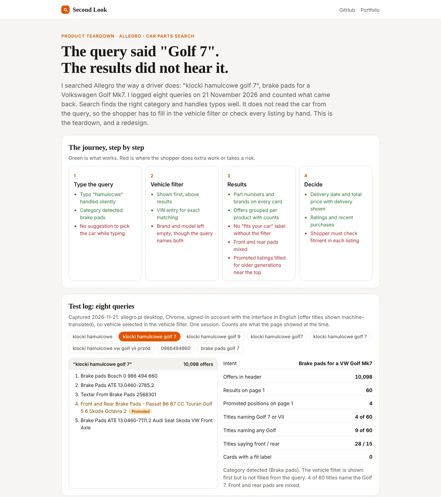

# Second Look

**A product teardown of Allegro search for car parts, with a logged test of eight queries and a redesigned flow.**

**Current version:** 0.1.0

Live: https://kostasxeras.com/second-look/



## The question

Car parts are one of the hardest search problems in e-commerce: a part is only relevant if it fits the shopper's car. Drivers usually put the car in the query, for example "klocki hamulcowe golf 7" (brake pads for a VW Golf Mk7). I wanted to see how Allegro, the large Polish marketplace, handles that query, measure it rather than describe it, and propose a fix. I work on search for an automotive parts catalogue, so this is close to my day job.

## Who it is for

- Product managers and search teams in marketplaces with fitment-dependent products
- Hiring managers who want to see how I run a teardown: evidence first, then design

## What is inside

- **Journey map** across four steps with what works and what breaks
- **Test log explorer**: eight queries with offer counts, top 5 results, promoted positions and title counts, loaded from data/tests.json
- **Findings** split into confirmed in the test log and hypotheses not tested
- **Weighted scorecard** with adjustable weights
- **Interactive redesign**: today against a flow that reads the car from the query, with fit labels on every card
- **Measurement plan** with placeholders for real baselines

## Main findings

Full detail in the [case study](docs/case-study.md).

- **The car in the query barely changes the results** (confirmed in the test log). "golf 9", a generation number not on sale at the time of the test, returned 11,517 offers with no warning, more than "golf 7" (10,098). Only 4 of 60 results on page 1 for "golf 7" name the Golf 7. The vehicle filter stays empty.
- **Promoted listings titled for other cars sit near the top** (confirmed in the test log). A promoted pad set titled for Golf 5 and 6 and Passat was at position 4 for "golf 7", and at positions 1 and 2 with a typo or "golf 9".
- **Position words work** (confirmed in the test log). Adding "przód" (front) moved page 1 from 28 front and 15 rear titles to 37 front and 1 rear.
- **Part number search finds the part, then pads the list** (confirmed in the test log). "0986494660" puts the exact part first, then 42 other part numbers on page 1, with a count of 9,419 offers.
- **English queries are much less precise** (confirmed in the test log). "brake pads golf 7" returned 56,862 offers, 5.6 times the Polish query.
- **Skipping the vehicle filter likely drives wrong-fit returns** (hypothesis). I cannot see Allegro's return data, so the size is [unknown].

## Data and sources

The test log is in [data/tests.json](data/tests.json). Eight queries were run once each on 21 November 2026 on allegro.pl, desktop Chrome, signed in, with the interface in English, so offer titles appear machine-translated. No vehicle was selected. Counts were read from the page. Results can differ by account, location, time and device. Allegro is not involved in this project. No screenshots of the site are published, to keep account details out of the repo.

## Decisions

- [Log queries and count, instead of describing impressions](docs/decisions/0001-measure-not-describe.md)
- [Use titles as a proxy for visible fitment](docs/decisions/0002-titles-as-proxy.md)
- [Placeholder products in the redesign](docs/decisions/0003-placeholder-mockup.md)

## How I would measure success

These are the measures I would propose to Allegro's search team. I have no access to their data.

| Measure | Definition | Target |
|---|---|---|
| Vehicle set rate | Share of car parts searches that end with a vehicle selected | [baseline] to [target] |
| Wrong-fit returns | Returns with reason "does not fit" per 1,000 car parts orders | [baseline] down [x]% |
| Search to purchase | Conversion of car parts searches with a vehicle in the query | [target] |

## What I would do next

1. Repeat the log on mobile and signed out, to see how much the account changes results
2. Add 20 more queries across other car makes and part types
3. Test the redesign as a clickable prototype with [number] drivers

## My role

I framed the problem, made the product calls and wrote the conclusions. 

## Run it yourself

One HTML page with no build step. Open `index.html` through any local web server, for example `python3 -m http.server`, then go to http://localhost:8000.

## Repo layout

```
index.html               The page
app.css                  Shared base styles
docs/product-brief.md    Problem, users, goals, scope
docs/case-study.md       Approach, decisions, findings, next steps
docs/decisions/          One record per real tradeoff
docs/screenshots/        Desktop and mobile
```
